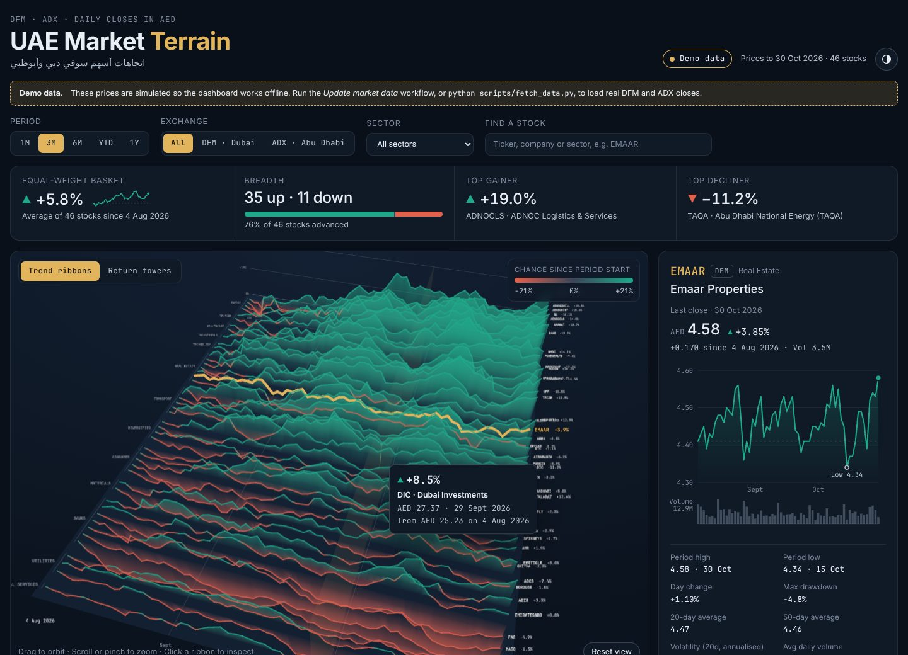

# UAE Market Terrain

An interactive 3D dashboard of price trends for stocks listed on the **Dubai Financial Market (DFM)** and the **Abu Dhabi Securities Exchange (ADX)**. Every stock gets its own trend: a ribbon in the 3D terrain, a tower in the return view, a sparkline in the stock board, and a full price and volume chart when you select it.



The screenshot uses the bundled demo data. Run the update workflow to switch to real closing prices.

## What's on the page

- **Trend ribbons (3D).** One lane per stock, grouped by sector. Time runs left to right, and height is the % change since the start of the chosen period, so every stock shares one scale. Teal marks gains and coral marks losses. Hover for the exact close on any day; click a ribbon to inspect it.
- **Return towers (3D).** One column per stock, grouped into sector "districts". Height is the change over the period: towers rise above the floor for gains and sink below it for losses.
- **Filters.** Period (1M, 3M, 6M, YTD, 1Y), exchange (DFM or ADX), sector, and search by ticker, company or sector. Filters apply to every view at once.
- **Summary strip.** Equal-weight basket return, market breadth (advancers and decliners), and the top gainer and decliner.
- **Detail panel.** Price chart with a crosshair (works with the mouse or the arrow keys), period high and low, volume, day change, max drawdown, 20- and 50-day averages, 20-day annualised volatility, and a simple trend signal.
- **Stock board.** A sortable table with a sparkline for each stock. Clicking a row flies the 3D camera to that stock.
- Light and dark themes, a phone layout, keyboard support, and shareable links such as `index.html#EMAAR`.

## Run it locally

The site is static: plain HTML, CSS and JavaScript modules, with [Three.js](https://threejs.org/) loaded from a CDN. There's no build step, but the page loads its data with `fetch`, so serve the folder over HTTP rather than opening the file directly:

```bash
python3 -m http.server 8000
```

Then open <http://localhost:8000>.

## Real market data

`data/stocks.json` ships with **simulated demo prices**, so the dashboard works out of the box. Whenever the data is simulated, the page shows a "Demo data" badge and banner.

To load real daily closes from Yahoo Finance (this needs internet access and only the Python standard library):

```bash
python3 scripts/fetch_data.py
```

If a symbol can't be downloaded, the script skips it and lists it in the page footer. If nothing downloads, the existing file is left alone.

### Automatic daily refresh

`.github/workflows/update-data.yml` runs the fetch script every weekday at 11:37 UTC (15:37 in the UAE, after the 15:00 close) and commits the new `data/stocks.json`. To start it:

1. Go to **Settings → Actions → General → Workflow permissions**, choose **Read and write permissions** and click **Save**, so the workflow can commit the new data.
2. Open **Actions → Update market data → Run workflow** to fetch real data right away.

### Regenerate the demo data

```bash
python3 scripts/fetch_data.py --demo --end 2026-10-30
```

## Add or remove stocks

Edit `data/universe.json`. Each entry needs a short `symbol`, the Yahoo Finance symbol (`yahoo`, which ends in `.AE` for UAE listings), the company `name`, the `exchange` (`DFM` or `ADX`) and a `sector`. Then run the fetch script again.

## Publish with GitHub Pages

Go to **Settings → Pages**, choose **Deploy from a branch**, and pick the default branch with the `/ (root)` folder. The dashboard is then served at `https://<user>.github.io/<repo>/`, and each daily data commit republishes it.

## Project layout

```
index.html                 page structure
css/styles.css             theme tokens (dark and light) and layout
js/main.js                 state, filters, summary, detail panel, stock board
js/scene.js                Three.js scene: trend ribbons and return towers
js/charts.js               SVG sparklines and the detail price chart
js/data.js                 data loading and per-period metrics
js/format.js               number and date formatting
data/universe.json         the list of tracked stocks
data/stocks.json           generated price history (demo or live)
scripts/fetch_data.py      downloads prices or writes demo data
.github/workflows/         scheduled data refresh
```

## Notes

- Prices are end-of-day closes in AED from Yahoo Finance's public chart endpoint. That endpoint is unofficial and can change or rate-limit without notice.
- UAE markets trade Monday to Friday, 10:00–15:00 Gulf Standard Time (UTC+4).
- The trend signal only compares the latest close with its 20- and 50-day averages. This dashboard is for information and is not investment advice.
